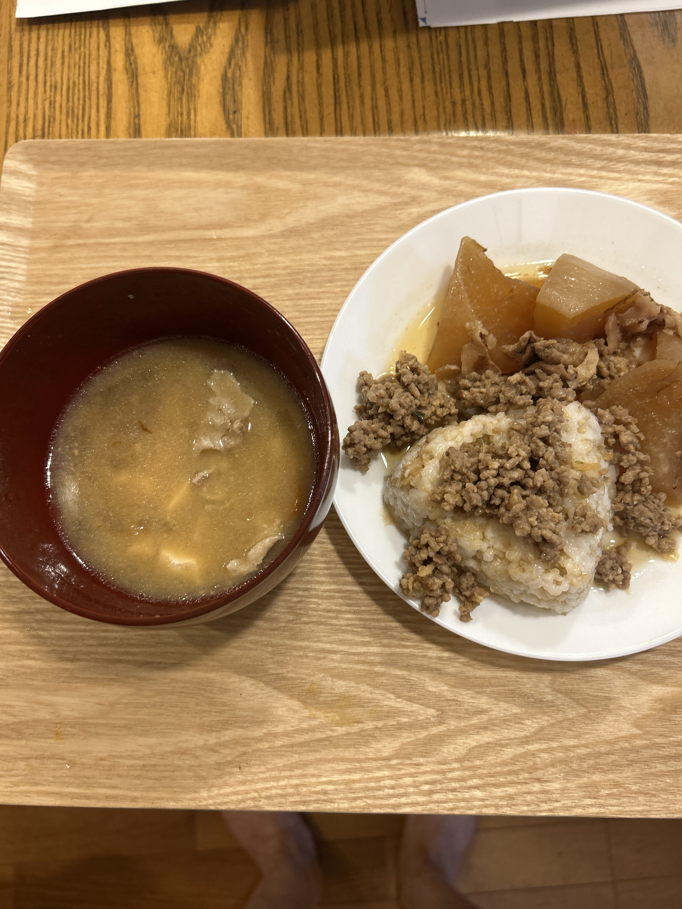

# eat-log
日々の食事と体調を綴る。最近だるくて運動がしづらいので、食事を見直してみる。

**目的**: 毎回の食事を写真と一緒に記録し、食べたものと体調の関係をあとから振り返れるようにする。

---

## 記録のしかた（運用）

1. 食事のたびにスマホで写真を撮る（昼・夜・おやつ。朝は食べた日だけ）
2. Claudeに写真と、食べたものを送る（日付・区分が違うときはそれも伝える）
3. Claudeがこのリポジトリに写真を追加し、READMEの該当日付に追記してプッシュする

写真を撮り忘れたときや、写っていないもの（例：あとで食べたケーキ）も、文字だけで送ればOK。

### 送るときの例
```
今日の昼。鮭おにぎり、ゆで卵、野菜スープ
メモ：午後眠かった
```

---

## 記録ルール

- **日付**: `### YYYY-MM-DD（曜）` の見出しで1日ごとにまとめる。新しい日付を上に追加する
- **区分**: 朝（食べた日のみ）／昼／おやつ／夜 の順に並べる
- **体重**: わかる日は見出しの横に `前日体重 〇〇kg` と書く（任意）
- **メモ**: 体調・気分・眠気など、気づいたことを区分の下に書く（任意）
- **写真**: `photos/` フォルダに保存し、ファイル名は日付と区分で付ける
  - 昼 `YYYY-MM-DD_lunch.jpg`／夜 `YYYY-MM-DD_dinner.jpg`／おやつ `YYYY-MM-DD_snack.jpg`／朝 `YYYY-MM-DD_breakfast.jpg`
  - 同じ区分で2枚以上あるときは `_snack2.jpg` のように番号を付ける

### 1日分のテンプレート
```markdown
### 2026-10-14（水）　　前日体重 00.0kg
* **昼**: 食べたもの
  * 
* **おやつ**: 食べたもの
  * 
* **夜**: 食べたもの
  * 
  * **メモ**: 体調など
```

---

## 食事記録

### 2026-10-13（火）
* **おやつ**: ケーキ
* **夜**: 豚汁、玄米ご飯、大根の煮物、ひき肉味噌
  * 

### 2026-09-01（火）　　前日体重 58.0kg
* **朝**: 玄米 茶碗一杯、豆乳ヨーグルト メープルシロップ、鶏胸肉とブロッコリーの甘辛焼き、ハーブティー
  * **メモ**: ダルい、眠い
* **おやつ**: おからケーキ、黒豆コーヒー豆乳ラテ
  * 
サジー豆乳　豆乳ヨーグルト
* **夜**: 玄米　豆腐とワカメと白菜の味噌汁　鯖焼き

---

## 身体計測画像

** 8月11日

<div style="display: grid; grid-template-columns: repeat(4, 1fr); gap: 10px;">
  
  
  
  
  
  
  
  
</div>
